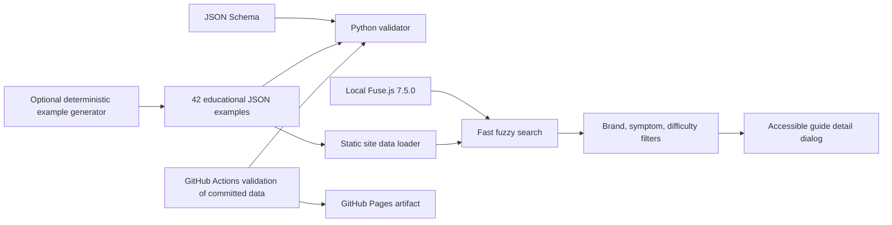
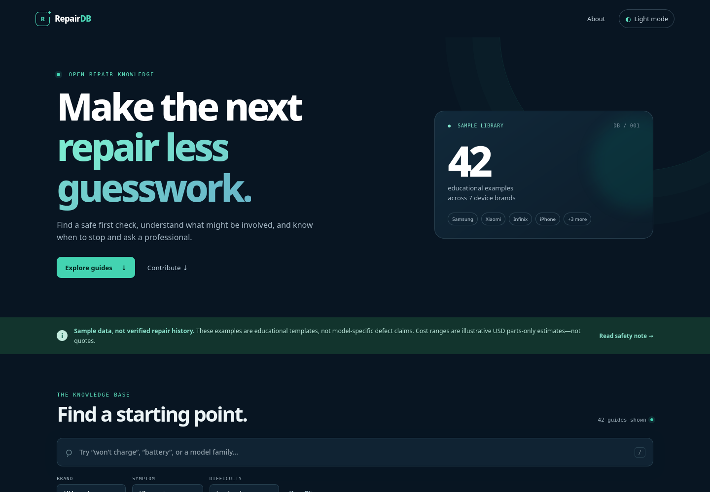
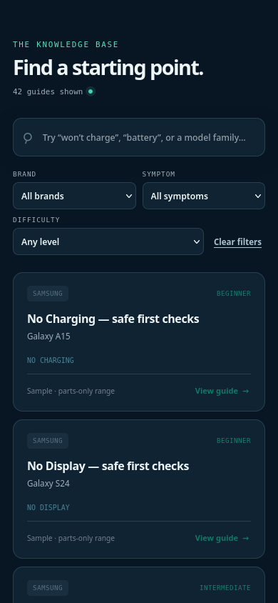

# RepairDB

[](https://github.com/specter-sec/repairdb/actions/workflows/validate.yml)
[Website](https://specter-sec.github.io/repairdb/) · [Contribute](CONTRIBUTING.md) · [Safety](SAFETY.md)

**RepairDB** is an open, safety-first learning reference for people who want to understand common phone symptoms before attempting repair. It helps readers find a calm, non-invasive starting point, see which components may be involved, and recognize when professional service is the right next step.

> **Important: this repository currently contains 42 educational examples, not verified repair records.** Each example names a real phone model to make the illustrations concrete, but none asserts that a listed fault is known for that model. The sample cost ranges are illustrative USD **parts-only** ranges, not quotes or predictions. See [SAFETY.md](SAFETY.md) before acting on any guidance.

Maintainer/display name: **IFTIKHAR**. License: MIT for original project code/content; vendored Fuse.js retains its Apache-2.0 license.

## Vision

Make troubleshooting easier to approach without rewarding risky guesswork. RepairDB favors useful symptom language, transparent uncertainty, accessible browsing, and safe first checks over unsupported claims of certainty. Future community contributions should be reviewable, clearly scoped, and careful about evidence.

## Architecture



Each brand has a compact JSON file in `data/`. `scripts/generate_dataset.py` can regenerate the six illustrative records per brand, but is not part of ordinary contributions or CI: its default command overwrites all seven committed data files. `schema/repair-entry.schema.json` is the data contract. `src/repairdb/validate.py` checks every record against that contract, including duplicate IDs and the brand/file partition. GitHub Actions validates the committed dataset and can deploy the static site to Pages on pushes to `main`; it does not regenerate data before validation or deployment.

## Run locally

Requires Python 3.10+ and a modern browser. From the repository root:

```bash
python -m venv .venv
# Linux/macOS: source .venv/bin/activate
# Windows PowerShell: .venv\Scripts\Activate.ps1
python -m pip install -e '.[test]'
PYTHONPATH=src python -m repairdb.validate
python -m pytest -q
python scripts/build_site.py
python -m http.server 8000
```

Open `http://127.0.0.1:8000/`. A local HTTP server is required because browsers block `fetch()` from `file://` pages. The source dataset is already committed; edit it directly for contributions. If you intentionally want to reset all sample records from the templates, run `python scripts/generate_dataset.py` (destructive: it overwrites every `data/*.json` file). To inspect generator output without touching committed data, use `python scripts/generate_dataset.py --output-dir /tmp/repairdb-generated`. The web app requires no build-time JavaScript dependencies.

Search supports fuzzy matching across symptom, brand, model, components, and guidance. Brand, symptom, and difficulty filters combine with search. The theme preference is saved in the browser. Keyboard users can press `/` to focus search; tab navigation, visible focus, a skip link, live result counts, and an accessible modal are provided.

## Data contract and contribution

See [`CONTRIBUTING.md`](CONTRIBUTING.md) for the required entry template, validation commands, and review standards. New records must be explicitly identified as educational unless supported, scoped evidence is supplied and separately reviewed. Do not convert a user anecdote or a parts estimate into an “official” diagnosis.

## GitHub Pages

The checked-in workflow `.github/workflows/pages.yml` validates the committed dataset, builds a minimal `_site/` artifact, and deploys it from `main`. In the repository settings, select **Settings → Pages → Build and deployment → GitHub Actions**. The maintainer or repository owner must enable Pages and allow Actions deployment. The workflow uses GitHub Actions pinned to immutable commit SHAs.

## Screenshots

Actual browser captures of the running static site using the committed educational dataset. These are not mockups and contain no customer information.





The desktop capture is 1440 × 1000; the mobile capture is 390 × 844. Reproduce by starting the local HTTP server and opening the site in a modern browser. Search, brand filtering, empty results, guide dialogs, dark-mode persistence, and phone-width overflow were also smoke-tested in a real browser.

## Roadmap

1. Review the sample dataset wording and accessibility with repair educators and experienced technicians.
2. Add carefully sourced, model-specific information only with precise citations, scope, and safety review.
3. Expand translations and make symptom labels easier to understand for first-time repair learners.
4. Improve keyboard and screen-reader testing and add a lightweight browser-level smoke test.
5. Consider a transparent versioning and community correction process before adding further datasets.

## General safety reference

Apple’s [Self Service Repair](https://support.apple.com/self-service-repair) guidance is linked here only as general context: Apple says the program is intended for people with knowledge and experience repairing electronic devices and directs users to the repair manual for their exact model. This is not a source for any sample fault in this project, and RepairDB is not affiliated with Apple.
